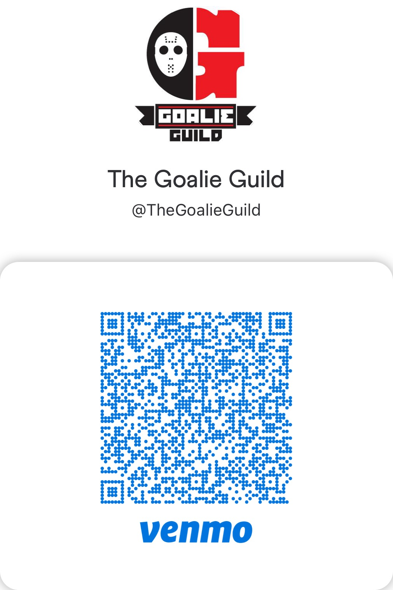

# 🔴 Donate

The Goalie Guild is registered as a <mark style="color:red;">501-c3 nonprofit</mark> status in the state of Colorado. As a public charity, donors can deduct their contributions under IRC Section 170. We are also qualified to receive tax deductible bequests, transfers, or gifts under Sections 2055, 2106, and 2522.&#x20;

We rely heavily on the goaltending community's support to operate, so we appreciate any type of contribution or donation that you can make. Below are the various ways you can currently donate.

## Venmo Charity

<figure><figcaption></figcaption></figure>

## PayPal Charity

**Link:** [PayPal.Me/thegoalieguild](https://www.paypal.com/paypalme/thegoalieguild?v=1\&utm_source=unp\&utm_medium=email\&utm_campaign=RT000481\&utm_unptid=5b182ce4-3e16-11ee-b50f-40a6b729018d\&ppid=RT000481\&cnac=US\&rsta=en_US%28en-US%29\&cust=N4EUP6J3LJQX4\&unptid=5b182ce4-3e16-11ee-b50f-40a6b729018d\&calc=f475499ab3ba8\&unp_tpcid=ppme-social-business-profile-created\&page=main%3Aemail%3ART000481\&pgrp=main%3Aemail\&e=cl\&mchn=em\&s=ci\&mail=sys\&appVersion=1.195.0\&xt=104038%2C124817)

**QR Code:**

&#x20;

## Check

Please make checks payable to: \
\
_The Goalie Guild, Inc._

## Contributions

We accept a variety of Contributions to our foundation. This includes Products, Coupons, Giveaways, Promo Items, and anything else that the goalie community would enjoy.&#x20;

## Products

We are actively seeking various products that we can pass along to our patrons and community members:&#x20;

* Goalie Equipment
* Training Tools
* Apparel (hoodies, shirts, hats)
* Gift Certificates
* Private Lessons / Camps
* Anything Goalie Related

## Volunteers

The Goalie Guild is seeking volunteers to help with fundraising and marketing initiatives. We use our social media platforms to promote charity events, important causes, mental health, and more We also have opportunities for freelance graphic designers, writers, and community builders.

If you are interested in volunteering for our foundation, please send us an email to <mark style="color:red;">info@thegoalieguild.com</mark> with "Volunteer" in the subject line.

