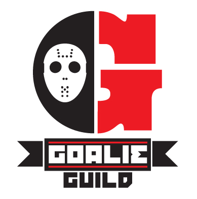

# 🔴 Intro

<figure><figcaption>
Official Logo
</figcaption></figure>

## Introduction

[The Goalie Guild](https://www.thegoalieguild.com) is a 501-c3 nonprofit foundation dedicated to serving the goalie community.&#x20;

## What We Do

The Goalie Guild offers a wide range of educational resources and financial aid. This includes [scholarships](../scholarships/ "mention"), [books.md](../../resources/books.md "mention"), and our [Lift The Mask](https://www.liftthemask.com) program. We also provide the goalie coaching community with professional development opportunities like our annual [ggr](../../resources/ggr/ "mention").

## Brief History

The Goalie Guild was originally created in 2009 by Justin Goldman as a home for his independent goaltending analysis, scouting reports, and popular [PadsTracker](https://thegoaliearchive.com/) project. As one of the first websites specifically dedicated to goaltending, it took flight and grew rapidly.&#x20;

In 2015, Goldman transformed The Goalie Guild into a 501-c3 nonprofit foundation. His mission is to offer scholarships and financial aid for underprivileged goalies, while also supporting mental health through a program called [Lift The Mask](https://www.liftthemask.com), which was establish in 2018.

## Charity Status

The Goalie Guild is registered as a <mark style="color:red;">501-c3 nonprofit</mark> status in the state of Colorado. We are qualified to receive tax deductible bequests, transfers, or gifts under Sections 2055, 2106, and 2522.&#x20;

We proudly hold a **Gold Seal of Transparency** on [**Candid**](https://app.candid.org/profile/9407983/?pkId=e90280a2-a91d-432e-a870-c37b7e730c1b\&isActive=true). View our profile by [clicking here](https://app.candid.org/profile/9407983/?pkId=e90280a2-a91d-432e-a870-c37b7e730c1b\&isActive=true).

<figure><figcaption>
2025 Seal
</figcaption></figure>

## Tax ID (EIN)

<mark style="color:red;">47-2675454</mark>

