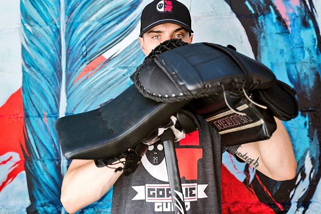

---
layout:
  width: default
  title:
    visible: true
  description:
    visible: false
  tableOfContents:
    visible: true
  outline:
    visible: true
  pagination:
    visible: true
  metadata:
    visible: true
  tags:
    visible: true
  actions:
    visible: true
  anchors:
    visible: true
---

# Mission

## _**To educate, support, and inspire the goaltending community.**_  

The Goalie Guild is a 501-c3 nonprofit foundation dedicated to supporting the goaltending community through accessible, affordable, and professional development resources like [scholarships](../scholarships/ "mention") and the [ggr](../../resources/ggr/ "mention") event.&#x20;

Our mission is supported by our long-term [vision.md](vision.md "mention").

<figure><figcaption>
The Goalie Guild is a foundation dedicated to supporting the goalie community.
</figcaption></figure>

