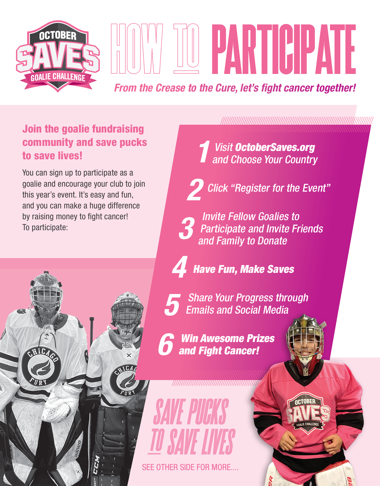
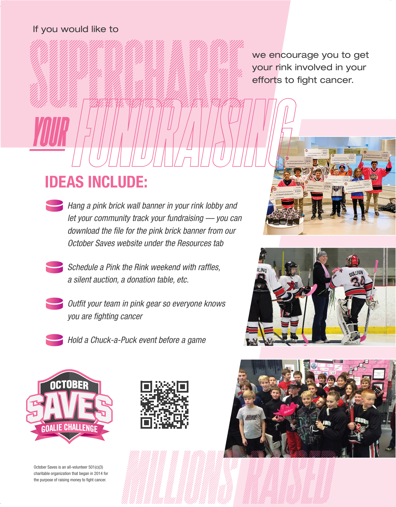

# October Saves

## Make Saves Count!

The [October Saves Goalie Challenge](https://www.octobersaves.org) is one of our biggest annual giving events each year.&#x20;

**October Saves** calls on ice hockey goalies - youth, amateur and professional - anywhere and everywhere to raise money and awareness through gathering donations for saves they make during Breast Cancer Awareness Month.

As a beneficiary of the event, The Goalie Guild receives a donation from the campaign each year. In return, we offer an annual scholarship for goalies affected by cancer. We also provide prizes for top fundraisers and promotional support through various channels.

Starting in 2024, The Goalie Guild also starting making random contributions directly to goalies that shared their fundraising pages on social media. Click below for more info!&#x20;

**October Saves Promotions:** [https://octobersaves.org/goalie-challenge/promote-your-campaign/](https://octobersaves.org/goalie-challenge/promote-your-campaign/)

<figure><figcaption></figcaption></figure> <figure><figcaption></figcaption></figure>

